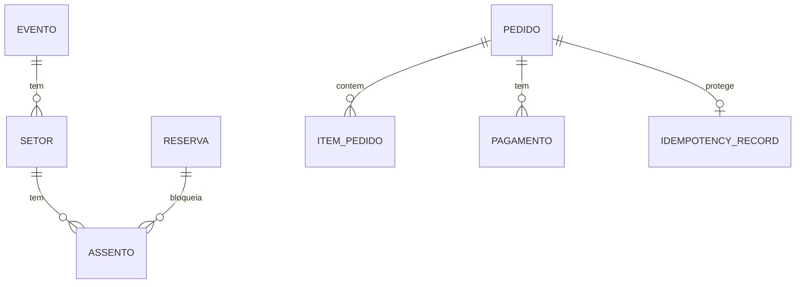

# Modelo de dados conceitual (fonte: Pacote 2, seção 4)

Um banco por serviço. Setas entre serviços são só IDs, sem FK. Diagrama: `docs/c4/er.png`.

| Serviço | Entidade | Campos principais |
|---|---|---|
| iam-admin | SolicitacaoOrganizador | id, usuarioId, status (PENDENTE/APROVADA/REJEITADA), decididoPor, decididoEm |
| iam-admin | AuditoriaRegistro | id, ator, acao, alvo, instante |
| inventory | Evento | id, organizadorId, nome, dataHora, local, status, vendasAbremEm |
| inventory | Setor | id, eventoId, nome, preco, capacidade, acessivel |
| inventory | Assento | id, setorId, fileira, numero, status (LIVRE/RESERVADO/VENDIDO), reservaId, expiraEm |
| inventory | Reserva | id (= pedidoId), usuarioId, status, criadaEm, expiraEm |
| order | Pedido | id, usuarioId, eventoId, reservaId, status, subtotal, taxa, total, criadoEm |
| order | ItemPedido | id, pedidoId, assentoId, setorNome, preco |
| order | Pagamento | id, pedidoId, status, valor, referenciaGateway, tentativas |
| order | IdempotencyRecord | chave, hashRequisicao, status, resposta, criadoEm |
| todos que publicam | OutboxEvent | id, agregadoId, tipo, payload, criadoEm, publicadoEm |
| todos que consomem | ProcessedMessage | grupo, eventId (PK composta), processadoEm |
| ticket (R2) | Ingresso, Notificacao | ver Pacote 2 |
| analytics (R2) | MetricaAgregada | janela, tipo, eventoId, valor |

Consistência: assento só fica RESERVADO com reserva ativa; atualização condicional (somente se LIVRE); reserva e pedido compartilham o id; todo evento nasce na outbox na mesma transação do fato.
