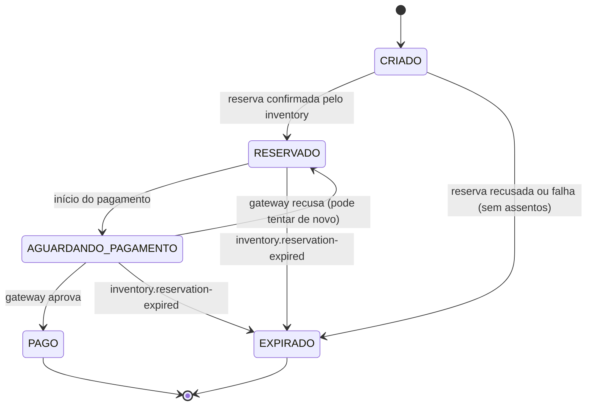

# Máquina de estados do pedido

| De | Evento/ação | Para | Observações |
|---|---|---|---|
| CRIADO | reserva ok | RESERVADO | grava `order.created`; guarda `expiraEm` |
| CRIADO | reserva falhou | EXPIRADO | assentos indisponíveis (409) |
| RESERVADO | pagar | AGUARDANDO_PAGAMENTO | exige Idempotency-Key |
| RESERVADO | expiração | EXPIRADO | publica `order.expired` |
| AGUARDANDO_PAGAMENTO | aprovado | PAGO | grava `order.paid` na outbox, mesma transação |
| AGUARDANDO_PAGAMENTO | recusado | RESERVADO | reserva continua válida até `expiraEm` |
| AGUARDANDO_PAGAMENTO | expiração | EXPIRADO | se o pagamento chegar depois, é recusado |
| PAGO, EXPIRADO | qualquer | - | estados finais; transição lança `InvalidOrderTransitionException` |

Regras: total = soma dos itens + taxa de serviço de 10%. Pedido PAGO nunca vira EXPIRADO (evento de expiração tardio é ignorado, mas registrado em `processed_message`). Testes unitários cobrem toda transição válida e inválida.
